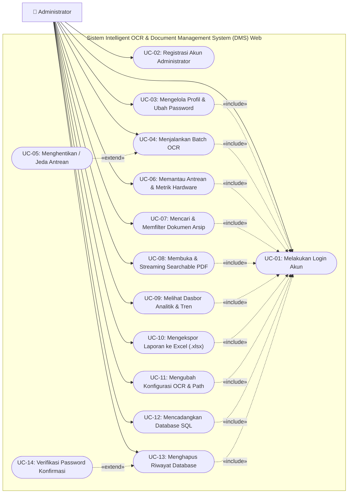

# 📘 DOKUMEN SPESIFIKASI KEBUTUHAN PERANGKAT LUNAK
## (SOFTWARE REQUIREMENTS SPECIFICATION - SRS)

---

| Parameter Dokumen | Informasi Resmi |
|---|---|
| **Nama Sistem** | Intelligent OCR & Document Management System (DMS) |
| **Instansi / Perusahaan** | PT Jawa Satu Power (JSP) |
| **Lokasi Operasional** | Power Plant Cilamaya, Karawang, Jawa Barat |
| **Standar Format** | IEEE Std 830-1998 / ISO/IEC/IEEE 29148:2018 |
| **Penulis / Pengembang** | Bagus Dwi Putra Setiawan |
| **Peran Pengembang** | Software Engineer & AI System Developer (Mahasiswa Kerja Praktik) |
| **Versi Dokumen** | 2.1 (Production & Academic Final Release) |
| **Tanggal Efektif** | Agustus 2026 |
| **Status Dokumen** | 🟢 Disetujui & Terverifikasi Siap Produksi |

---

## 📑 DAFTAR ISI LENGKAP

1. [BAB 1: PENDAHULUAN (INTRODUCTION)](#bab-1-pendahuluan)
   - 1.1 Tujuan Penulisan Dokumen
   - 1.2 Lingkup dan Batasan Produk
   - 1.3 Definisi, Istilah, dan Singkatan
   - 1.4 Referensi dan Standar Acuan
   - 1.5 Sistematika dan Gambaran Umum Dokumen
2. [BAB 2: DESKRIPSI UMUM SISTEM (OVERALL DESCRIPTION)](#bab-2-deskripsi-umum-sistem)
   - 2.1 Perspektif Produk dan Konteks Arsitektur
   - 2.2 Ringkasan Fungsi-Fungsi Utama Produk
   - 2.3 Profil dan Karakteristik Pengguna
   - 2.4 Batasan-Batasan Teknis dan Lingkungan
   - 2.5 Asumsi Operasional dan Ketergantungan
3. [BAB 3: KEBUTUHAN ANTARMUKA EKSTERNAL (EXTERNAL INTERFACE REQUIREMENTS)](#bab-3-kebutuhan-antarmuka-eksternal)
   - 3.1 Antarmuka Pengguna (User Interface)
   - 3.2 Antarmuka Perangkat Keras (Hardware Interface)
   - 3.3 Antarmuka Perangkat Lunak (Software Interface)
   - 3.4 Antarmuka Komunikasi dan Jaringan (Communication Interface)
4. [BAB 4: KEBUTUHAN FUNGSIONAL SISTEM (FUNCTIONAL REQUIREMENTS)](#bab-4-kebutuhan-fungsional)
   - 4.1 Modul 1: Autentikasi dan Manajemen Pengguna (FR-01 s.d FR-03)
   - 4.2 Modul 2: Core Engine OCR dan Multiprocessing (FR-04 s.d FR-07)
   - 4.3 Modul 3: Monitoring Antrean dan Log Terminal (FR-08 s.d FR-09)
   - 4.4 Modul 4: Manajemen Dokumen dan Pengarsipan Digital (FR-10 s.d FR-11)
   - 4.5 Modul 5: Analitik Kinerja dan Pelaporan Excel (FR-12 s.d FR-13)
   - 4.6 Modul 6: Konfigurasi Sistem dan Pemeliharaan Database (FR-14 s.d FR-16)
5. [BAB 5: KEBUTUHAN NON-FUNGSIONAL (NON-FUNCTIONAL REQUIREMENTS)](#bab-5-kebutuhan-non-fungsional)
   - 5.1 Parameter Keamanan Sistem (Security Requirements)
   - 5.2 Parameter Kinerja dan Waktu Respon (Performance Requirements)
   - 5.3 Parameter Keandalan dan Integritas Data (Reliability Requirements)
   - 5.4 Parameter Kemudahan Pemeliharaan (Maintainability Requirements)
   - 5.5 Parameter Kemudahan Penggunaan (Usability Requirements)
6. [BAB 6: PEMODELAN USE CASE DAN SKENARIO INTERAKSI SISTEM](#bab-6-pemodelan-use-case)
   - 6.1 Definisi Simbol Standar Diagram Use Case (UML 2.5)
   - 6.2 Diagram Use Case Sistem (UML Standard Diagram)
   - 6.3 Spesifikasi dan Tabel Skenario Use Case Rinci
7. [BAB 7: MATRIKS KETERLACAKAN KEBUTUHAN (REQUIREMENTS TRACEABILITY MATRIX)](#bab-7-matriks-keterlacakan)
   - 7.1 Pemetaan Kebutuhan Fungsional ke Kode dan Unit Test
8. [LEMBAR PENGESAHAN DOKUMEN](#lembar-pengesahan-dokumen)

---

## BAB 1: PENDAHULUAN

*Bab ini memberikan gambaran pengantar mengenai tujuan pembuatan dokumen SRS, cakupan perangkat lunak yang dikembangkan, definisi istilah teknis yang digunakan, serta panduan bagi pembaca dari kalangan akademisi maupun praktisi industri di PT Jawa Satu Power.*

### 1.1 Tujuan Penulisan Dokumen
Dokumen **Spesifikasi Kebutuhan Perangkat Lunak (Software Requirements Specification - SRS)** ini disusun sebagai cetak biru (*blueprint*) spesifikasi formal untuk pengembangan dan audit sistem **Intelligent OCR & Document Management System (DMS)**. Dokumen ini bertujuan untuk:
1. Mendokumentasikan secara rinci seluruh kebutuhan fungsional dan non-fungsional yang harus dipenuhi oleh sistem.
2. Menjadi kontrak teknis yang menyelaraskan ekspektasi antara pengembang sistem, operator lapangan, mentor industri di **PT Jawa Satu Power**, serta dosen pembimbing kerja praktik dari universitas.
3. Menjadi dasar pengujian (*testing baseline*) dan verifikasi kualitas sebelum sistem dioperasikan secara penuh pada lingkungan kerja produksi (*production environment*).

### 1.2 Lingkup dan Batasan Produk
Produk perangkat lunak yang dikembangkan adalah sistem digitalisasi arsip berbasis web (*Web-based Document Archival & Optical Character Recognition System*). 
* **Nama Resmi Produk:** Intelligent OCR & Document Management System (DMS).
* **Cakupan Kerja Sistem:**
  * Memindai folder direktori input dokumen secara rekursif (*recursive folder scanning*).
  * Mengekstrak teks dari berkas PDF hasil scan dan citra gambar (`.png`, `.jpg`, `.jpeg`, `.tiff`, `.bmp`, `.webp`) menggunakan engine Tesseract OCR v5 dan PyMuPDF.
  * Mengonversi dokumen menjadi format **Searchable PDF** (PDF yang teksnya dapat dicari dan disalin) dengan kompresi tingkat tinggi (*high-ratio deflate compression*) tanpa menurunkan keterbacaan visual.
  * Mengoptimalkan beban pemrosesan melalui mekanisme **Smart Skip** untuk dokumen digital dan **Lanczos Smart Upscaling + Dual-Pass PSM** untuk diagram teknis pembangkit.
  * Menyajikan dasbor pemantauan beban antrean (*real-time queue monitoring*), telemetri hardware server (CPU/RAM/Disk), analitik tren keberhasilan, serta generator laporan spreadsheet Excel multi-sheet.

### 1.3 Definisi, Istilah, dan Singkatan
Untuk mempermudah pemahaman seluruh pihak yang membaca dokumen ini, berikut adalah daftar definisi istilah yang digunakan:

| Istilah / Akronim | Definisi dan Keterangan Teknis |
|---|---|
| **OCR** | *Optical Character Recognition* — Teknologi komputasi visual untuk mengenali karakter teks yang terdapat di dalam gambar atau pindaian dokumen fisik. |
| **DMS** | *Document Management System* — Sistem perangkat lunak untuk menyimpan, mengelola, mengindeks, dan melacak dokumen digital. |
| **Searchable PDF** | Berkas PDF yang memiliki dua lapisan: lapisan visual gambar dokumen asli di depan, dan lapisan teks digital tersembunyi (*invisible text layer*) di belakangnya sehingga teks dapat disorot, disalin, dan dicari menggunakan fitur *Ctrl + F*. |
| **Smart Skip** | Algoritma optimasi internal untuk mendeteksi apakah suatu halaman PDF sudah memiliki teks digital asli (bukan hasil scan). Jika ya, proses OCR dilompati untuk menghemat waktu komputasi hingga 80%. |
| **Lanczos Upscaling** | Algoritma interpolasi matematika berorde tinggi untuk memperbesar dimensi piksel gambar diagram beresolusi rendah secara tajam sebelum diproses oleh OCR. |
| **PSM** | *Page Segmentation Mode* — Mode pengaturan tata letak halaman pada engine Tesseract OCR (misal: PSM 3 untuk paragraf dokumen penuh, PSM 11 untuk diagram/teks tersebar). |
| **MVC** | *Model-View-Controller* — Pola arsitektur rekayasa perangkat lunak yang memisahkan struktur data (Model), tampilan pengguna (View), dan alur logika bisnis (Controller). |
| **SOLID** | Lima prinsip desain berorientasi objek (*Single Responsibility, Open/Closed, Liskov Substitution, Interface Segregation, Dependency Inversion*) agar kode mudah dipelihara dan diuji. |
| **JSP** | PT Jawa Satu Power — Perusahaan pengelola Pembangkit Listrik Tenaga Gas dan Uap (PLTGU) Jawa-1 di Cilamaya, Karawang. |
| **CSRF** | *Cross-Site Request Forgery* — Jenis serangan keamanan web di mana penyerang memalsukan perintah dari pengguna yang sah. |
| **Gunicorn** | *Green Unicorn* — Server Web Server Gateway Interface (WSGI) standar industri untuk menjalankan aplikasi Python Flask di lingkungan Linux. |

### 1.4 Referensi dan Standar Acuan
1. **IEEE Std 830-1998:** *IEEE Recommended Practice for Software Requirements Specifications*, IEEE Computer Society.
2. **ISO/IEC/IEEE 29148:2018:** *Systems and software engineering — Life cycle processes — Requirements engineering*.
3. **The Clean Architecture & SOLID Principles:** Robert C. Martin (Uncle Bob), Prentice Hall.
4. **OWASP Top 10 Web Application Security Risks:** Open Web Application Security Project (2021/2026).

### 1.5 Sistematika dan Gambaran Umum Dokumen
Dokumen ini disusun secara hierarkis dan terstruktur:
* **BAB 1** mendefinisikan latar belakang, tujuan, dan istilah.
* **BAB 2** menguraikan perspektif umum, fungsi utama, peran pengguna, dan batasan operasional.
* **BAB 3** menjelaskan kebutuhan antarmuka pengguna, perangkat keras, software pendukung, dan protokol jaringan.
* **BAB 4** merinci setiap Kebutuhan Fungsional (FR-01 s.d FR-16) per modul.
* **BAB 5** merinci Kebutuhan Non-Fungsional (NFR-01 s.d NFR-06) terkait keamanan, performa, dan keandalan.
* **BAB 6** memuat Pemodelan Use Case standar UML beserta tabel skenario langkah kerja interaksinya.
* **BAB 7** menyajikan Matriks Keterlacakan (*Traceability Matrix*) yang memetakan kebutuhan ke berkas kode dan automated test.

---

## BAB 2: DESKRIPSI UMUM SISTEM

*Bab ini menjelaskan sistem secara makro, mencakup konteks penempatannya pada infrastruktur PT Jawa Satu Power, siapa saja yang mengoperasikannya, batasan operasional, serta asumsi-asumsi teknis yang berlaku.*

### 2.1 Perspektif Produk dan Konteks Arsitektur
Sistem OCR DMS dirancang sebagai aplikasi terpusat (*Centralized On-Premise Web Application*). Sistem ini dipasang pada server lokal internal di lingkungan pembangkit listrik PT Jawa Satu Power dan diakses oleh operator maupun tim teknik melalui jaringan intranet kantor.

```
┌────────────────────────────────────────────────────────────────────────────┐
│                    LINGKUNGAN INFRASTRUKTUR OPERASIONAL                    │
├────────────────────────────────────────────────────────────────────────────┤
│                                                                            │
│   [Klien / Komputer Operator] ────(Jaringan Intranet / Browser Web)────┐   │
│                                                                        │   │
│                                                                        ▼   │
│ ┌────────────────────────────────────────────────────────────────────────┐ │
│ │ SERVER UBUNTU LINUX (PT JAWA SATU POWER)                               │ │
│ │                                                                        │ │
│ │  ┌──────────────────────────────────────────────────────────────────┐  │ │
│ │  │ Web Server Layer: Gunicorn WSGI Server (Port 5000)               │  │ │
│ │  └─────────────────────────────────┬────────────────────────────────┘  │ │
│ │                                    ▼                                   │ │
│ │  ┌──────────────────────────────────────────────────────────────────┐  │ │
│ │  │ Application Core: Flask Framework (MVC + Service Layer)          │  │ │
│ │  └───────┬─────────────────────────┬────────────────────────┬───────┘  │ │
│ │          │                         │                        │          │ │
│ │          ▼                         ▼                        ▼          │ │
│ │  ┌────────────────┐       ┌─────────────────┐      ┌────────────────┐  │ │
│ │  │ Database Layer │       │ OCR & PDF Core  │      │ File Storage   │  │ │
│ │  │ MySQL Database │       │ Tesseract CLI   │      │ input_pdf/     │  │ │
│ │  │ (users,riwayat)│       │ PyMuPDF (fitz)  │      │ output_pdf/    │  │ │
│ │  └────────────────┘       └─────────────────┘      └────────────────┘  │ │
│ └────────────────────────────────────────────────────────────────────────┘ │
└────────────────────────────────────────────────────────────────────────────┘
```

Karakteristik utama dari perspektif arsitektur ini adalah **100% On-Premise & Confidential**. Tidak ada data dokumen operasional, gambar turbin, maupun surat dinas yang dikirimkan ke cloud pihak ketiga, sehingga mematuhi kebijakan keamanan informasi internal perusahaan.

### 2.2 Ringkasan Fungsi-Fungsi Utama Produk
Sistem menyediakan enam kelompok kapabilitas fungsional utama:
1. **Otomatisasi Batch OCR Multiprocessing:** Memproses antrean ratusan dokumen secara paralel dengan pembagian core CPU yang efisien.
2. **Dual-Pass OCR & Smart Upscaling:** Mampu mengekstrak teks dokumen standar sekaligus diagram alur (*flowchart*) dan skema kelistrikan (*Single Line Diagram*).
3. **Pengarsipan & Pencarian Multi-Kolom:** Menyimpan seluruh metadata dokumen terindeks (*author, subject, keywords, creation date*) dan menyediakan pencarian instan.
4. **Live Monitoring & Hardware Telemetry:** Memantau kemajuan proses per halaman dan utilisasi sumber daya CPU/RAM/Disk server.
5. **Pelaporan Bisnis & Ekspor Excel:** Menyediakan grafik analitik tren performa dan ekspor laporan terformat rapi (`.xlsx`).
6. **Keamanan & Pemeliharaan Database:** Proteksi login, pembatasan registrasi, pencadangan SQL lengkap, dan penghapusan riwayat terproteksi password.

### 2.3 Profil dan Karakteristik Pengguna
Sistem dirancang untuk dioperasikan oleh **1 peran aktor utama**, yaitu **Administrator Sistem (Admin)** yang memegang kendali operasional penuh:

| Kategori Pengguna | Tanggung Jawab & Hak Akses | Tingkat Pendidikan / Keahlian |
|---|---|---|
| **Administrator (Admin)** | • Melakukan login dan inisiasi akun sistem.<br>• Memicu dan mengontrol pemrosesan batch OCR multiprocessing.<br>• Memantau progress antrean dan telemetri hardware server (CPU/RAM/Disk).<br>• Mencari, memfilter, membuka streaming PDF, dan mengunduh Searchable PDF.<br>• Mengekspor laporan riwayat ke spreadsheet Excel (`.xlsx`).<br>• Mengonfigurasi parameter OCR (DPI render, bahasa, max retry, folder path).<br>• Melakukan pencadangan database SQL lengkap (16 kolom).<br>• Melakukan reset database terproteksi password dengan snapshot JSON otomatis. | Sarjana/Teknisi IT atau Operator Pengarsipan Pembangkit Listrik yang menguasai browser web dan operasional file dokumen. |

### 2.4 Batasan-Batasan Teknis dan Lingkungan
1. **Sistem Operasi Target:** Ubuntu Server 22.04 / 24.04 LTS (didukung pula pada Windows 10/11 untuk workstation pengembangan).
2. **Kapasitas Memori:** Minimal RAM 4 GB untuk menampung rendering bitmap halaman PDF beresolusi tinggi tanpa kehabisan memori (*Out of Memory*).
3. **Kerahasiaan Jaringan:** Sistem hanya dapat diakses melalui jaringan lokal/VPN internal PT Jawa Satu Power.
4. **Format Input yang Didukung:** PDF (`.pdf`), PNG (`.png`), JPEG (`.jpg`, `.jpeg`), TIFF (`.tiff`), BMP (`.bmp`), WEBP (`.webp`).

### 2.5 Asumsi Operasional dan Ketergantungan
* File citra atau scan yang dimasukkan ke folder input memiliki resolusi visual minimal 150 DPI agar Tesseract OCR dapat mengenali karakter dengan akurasi optimal $\ge 90\%$.
* Binary `tesseract-ocr` dengan paket bahasa Indonesia (`tesseract-ocr-ind`) dan bahasa Inggris (`tesseract-ocr-eng`) telah terinstal dan terdaftar pada PATH server Ubuntu.

---

## BAB 3: KEBUTUHAN ANTARMUKA EKSTERNAL

*Bab ini mendefinisikan seluruh titik interaksi antara perangkat lunak dengan entitas eksternal, mencakup antarmuka visual pengguna, perangkat keras server, modul perangkat lunak pendukung, serta protokol komunikasi jaringan.*

### 3.1 Antarmuka Pengguna (User Interface)
Antarmuka pengguna dirancang dengan berpedoman pada prinsip modern UI/UX:
* **Halaman Login & Profil:** Form autentikasi responsif dengan validasi input interaktif, proteksi auto-fill kredensial, dan pesan notifikasi status (*Flash Alerts*).
* **Dasbor Utama (Dashboard):** Menampilkan ringkasan kartu metrik total dokumen, persentase keberhasilan, grafik lingkaran distribusi status, tabel 50 file terkini, dan tombol kontrol kendali OCR.
* **Halaman Monitoring Antrean:** Progress bar dinamis real-time, indikator status engine (Online / Processing / Idle / Paused), panel log konsol terminal, dan tabel antrean worker.
* **Halaman Dokumen:** Tabel arsip data interaktif dengan fitur pencarian multi-kolom, filter periode tanggal (*pill filters*), penampil jumlah baris (10, 25, 50, 100), pagination, dan tombol aksi pratinjau PDF di tab baru.
* **Halaman Analitik:** Visualisasi grafik garis (*Line Chart*) tren harian, grafik batang volume dokumen, dan kartu distribusi penggunaan storage disk.
* **Halaman Pengaturan:** Form konfigurasi DPI render, selector bahasa OCR, path direktori server, dan tombol cadangkan database SQL.

### 3.2 Antarmuka Perangkat Keras (Hardware Interface)
* **Processor (CPU):** Minimal 2 Core vCPU (Rekomendasi: 4–8 Core untuk kecepatan multiprocessing OCR).
* **Memori (RAM):** Minimal 4 GB DDR4 (Rekomendasi: 8–16 GB).
* **Penyimpanan (Storage):** Minimal ruang kosong 20 GB SSD untuk direktori `input_pdf/` dan `output_pdf/`.

### 3.3 Antarmuka Perangkat Lunak (Software Interface)
* **Database Management System:** MySQL Server versi 8.0+ atau MariaDB 10.5+ dengan driver `PyMySQL` via `SQLAlchemy ORM`.
* **Optical Character Recognition Engine:** Tesseract OCR Engine versi 5.x.
* **PDF & Document Rendering Engine:** PyMuPDF (`fitz`) versi 1.23+.
* **Image Pre-processing Library:** Pillow (PIL) versi 10.x dan OpenCV Headless versi 4.8+.
* **Spreadsheet Engine:** openpyxl versi 3.1+.
* **Hardware Monitor:** psutil versi 5.9+.

### 3.4 Antarmuka Komunikasi dan Jaringan (Communication Interface)
* **Protokol:** HTTP/1.1 dan WebSocket/AJAX Polling melalui port TCP `5000` (atau port `80`/`443` reverse proxy Nginx).
* **Format Data Pertukaran:** JSON (*JavaScript Object Notation*) untuk komunikasi asynchronous endpoint API (`/progress`, `/api/monitoring`, `/api/folders`, `/api/check_folder`).

---

## BAB 4: KEBUTUHAN FUNGSIONAL SISTEM

*Bab ini merupakan inti spesifikasi teknis yang menjabarkan seluruh 16 Kebutuhan Fungsional (Functional Requirements) yang dikelompokkan ke dalam 6 modul kerja sistem.*

```
┌────────────────────────────────────────────────────────────────────────┐
│               MATRIKS MODUL KEBUTUHAN FUNGSIONAL SISTEM                │
├─────────┬─────────────────────────────────────────────┬────────────────┤
│ ID Modul│ Nama Modul Fungsional                       │ Cakupan Kode   │
├─────────┼─────────────────────────────────────────────┼────────────────┤
│ MOD-01  │ Modul Autentikasi & Hak Akses Pengguna      │ FR-01 s.d FR-03│
│ MOD-02  │ Modul Core Engine OCR Multiprocessing       │ FR-04 s.d FR-07│
│ MOD-03  │ Modul Monitoring Antrean & Metrik Server    │ FR-08 s.d FR-09│
│ MOD-04  │ Modul Manajemen Dokumen & Arsip Digital     │ FR-10 s.d FR-11│
│ MOD-05  │ Modul Analitik Kinerja & Pelaporan Excel    │ FR-12 s.d FR-13│
│ MOD-06  │ Modul Pengaturan Sistem & Database          │ FR-14 s.d FR-16│
└─────────┴─────────────────────────────────────────────┴────────────────┘
```

---

### 4.1 Modul 1: Autentikasi dan Manajemen Pengguna

#### **FR-01: Autentikasi Pengguna & Manajemen Sesi**
* **Deskripsi:** Sistem harus menyediakan fungsi verifikasi identitas pengguna melalui form login berbasis web.
* **Masukan (*Input*):** `username` (string), `password` (string), `csrf_token` (string).
* **Proses:** 
  1. Sistem memverifikasi token CSRF.
  2. Sistem mencari record pengguna pada tabel `users` berdasarkan `username`.
  3. Sistem memvalidasi password menggunakan algoritma hashing `scrypt` / `pbkdf2:sha256`.
  4. Jika valid, sistem menginisiasi sesi Flask-Login dengan cookie terenkripsi dan memperbarui kolom `last_login`.
* **Keluaran (*Output*):** Pengalihan pengguna ke halaman Dasbor Utama jika berhasil, atau pesan peringatan bahaya (*Flash danger message*) jika kredensial salah.

#### **FR-02: Penguncian Registrasi Publik Otomatis**
* **Deskripsi:** Sistem harus mengizinkan pembuatan akun pertama (inisiasi admin awal), tetapi wajib menutup rute registrasi publik secara otomatis setelah terdapat minimal 1 akun di database.
* **Aturan Bisnis:** Registrasi hanya dapat dibuka kembali jika variabel lingkungan `ALLOW_REGISTRATION=true` disetel di file `.env`.
* **Keluaran:** Permintaan ke `/register` saat registrasi terkunci akan dialihkan ke `/login` dengan notifikasi: *"Pendaftaran akun baru ditutup oleh administrator"*.

#### **FR-03: Manajemen Profil Pengguna & Pembaruan Password**
* **Deskripsi:** Pengguna terautentikasi dapat melihat detail akunnya dan memperbarui password pribadinya.
* **Validasi Input:** Password lama harus sesuai, password baru minimal 6 karakter, dan password konfirmasi harus identik dengan password baru.

---

### 4.2 Modul 2: Core Engine OCR dan Multiprocessing

#### **FR-04: Pemindaian Rekursif & Replikasi Struktur Folder**
* **Deskripsi:** Sistem harus memindai folder input (`input_dir`) secara rekursif hingga subfolder terdalam dan otomatis membuat struktur folder yang identik (*mirror folder tree*) di folder output (`output_dir`).

#### **FR-05: Ekstraksi Searchable PDF Multiprocessing Paralel**
* **Deskripsi:** Sistem harus mengeksekusi proses konversi OCR secara paralel menggunakan `ProcessPoolExecutor` dengan jumlah worker sebanyak `(CPU_COUNT - 1)`.
* **Mekanisme Antrean:** Task diurutkan berdasarkan ukuran berkas terkecil (*Smallest File First*) untuk mempercepat penyelesaian berkas-berkas ringan terlebih dahulu.

#### **FR-06: Optimasi Smart Skip Dokumen Digital**
* **Deskripsi:** Sebelum merender bitmap dan memanggil Tesseract, sistem memeriksa apakah halaman PDF asli sudah mengandung teks digital (`len(teks) > 100`) dan tidak memiliki elemen gambar scan. Jika ya, halaman asli langsung disalin ke PDF output tanpa OCR untuk menghemat daya komputasi CPU.

#### **FR-07: Smart Upscaling Lanczos & Dual-Pass OCR untuk Diagram Teknis**
* **Deskripsi:** Untuk dokumen gambar atau skema diagram teknis beresolusi rendah (<1400px):
  1. Sistem melakukan *Lanczos Smart Upscaling* dan filter kontras 1.5x.
  2. **Pass 1:** Menjalankan OCR dengan `--psm 3` (Segmentasi Dokumen Standar).
  3. **Pass 2 Fallback:** Jika karakter teks terbaca $< 3$ karakter, sistem otomatis mengeksekusi ulang dengan mode `--psm 11` (*Sparse Text Detection*) agar teks pada diagram kelistrikan atau flowchart kotak dapat terbaca sempurna.

---

### 4.3 Modul 3: Monitoring Antrean dan Log Terminal

#### **FR-08: Pemantauan Antrean Real-time & Sinyal Kontrol (Stop & Pause/Resume)**
* **Deskripsi:** Sistem harus menyajikan antarmuka pemantauan antrean berkas OCR yang sedang aktif (*Active Tasks Queue*), nama berkas yang sedang diproses, nomor halaman aktif, progress bar per berkas, dan total task antrean yang diperbarui secara asinkron via AJAX polling (1.5–3 detik).
* **Fitur Kontrol Operasional:**
  1. **Penghentian Proses OCR (*Stop Button* via rute `/stop`):** Pengguna dapat menekan tombol **"Stop"** pada Dasbor Utama (dilengkapi modal konfirmasi keamanan) untuk mengirimkan sinyal interupsi pembatalan (`ocr_stop.signal`) agar background worker OCR berhenti dengan aman (*graceful termination*).
  2. **Jeda Antrean (*Pause/Resume Queue* via rute `/api/queue/pause`):** Pengguna dapat menekan tombol **"Jeda Antrean"** pada Halaman Monitoring untuk menangguhkan pengerjaan berkas berikutnya tanpa memutus pengerjaan berkas yang sedang aktif berjalan.

#### **FR-09: Live Log Terminal Konsol (ocr_worker_node_alpha.log)**
* **Deskripsi:** Sistem harus membaca dan menyajikan streaming baris log eksekusi OCR secara langsung (*live log streaming*) dari berkas log sistem ke dalam antarmuka panel terminal hitam dengan pewarnaan teks terminal, pemformatan baris terbaru, dan fitur kontrol **Auto-scroll ON/OFF**.

---

### 4.4 Modul 4: Manajemen Dokumen dan Pengarsipan Digital

#### **FR-10: Penelusuran Riwayat & Pencarian Multi-Kolom**
* **Deskripsi:** Sistem harus menyajikan tabel data seluruh dokumen riwayat pengerjaan OCR dengan fitur:
  * Pagination (10, 25, 50, 100 data per halaman).
  * Filter status (*Semua, Sukses, Gagal, Skip*).
  * Filter rentang tanggal (*Hari Ini, 7 Hari, 30 Hari, Bulan/Tahun Spesifik*).
  * Pencarian instan multi-kolom (`nama_file`, `folder_path`, `author`, `subject`, `keywords`, `keterangan`).

#### **FR-11: Streaming Penampil PDF Terproteksi (Anti Path-Traversal)**
* **Deskripsi:** Sistem harus menyediakan penampil file PDF hasil OCR di peramban web melalui rute `/lihat_pdf/<filename>` dengan verifikasi keamanan `os.path.commonpath` untuk memastikan file yang diminta berada di dalam folder output yang sah.

---

### 4.5 Modul 5: Analitik Kinerja dan Pelaporan Excel

#### **FR-12: Dasbor Analitik Performa Bisnis**
* **Deskripsi:** Sistem harus mengagregasi data riwayat menjadi metrik analitik:
  * *Success Rate Percentage* (%) dan rata-rata waktu pemrosesan (detik/file).
  * Grafik garis tren pengerjaan harian (*Daily Trend Chart*).
  * Grafik batang volume dokumen masuk (*Document Volume Chart*).
  * Pemeringkatan kontributor/penulis dokumen teraktif (*Top 5 Authors*).

#### **FR-13: Ekspor Laporan Spreadsheet Excel (.xlsx) Multi-Sheet**
* **Deskripsi:** Sistem harus menghasilkan berkas laporan spreadsheet Excel profesional menggunakan `openpyxl` yang memuat dua lembar kerja:
  * **Sheet 1 ("Ringkasan"):** Metrik kinerja dan indikator keberhasilan.
  * **Sheet 2 ("Data Lengkap"):** Tabel riwayat 13 kolom lengkap dengan pewarnaan badge status dan format tanggal rapi.

---

### 4.6 Modul 6: Konfigurasi Sistem dan Pemeliharaan Database

#### **FR-14: Pengaturan Konfigurasi Runtime Dinamis**
* **Deskripsi:** Administrator dapat mengubah konfigurasi sistem tanpa restart server:
  * Resolusi Rendering DPI (72 s.d 600 DPI, default 150/200 DPI).
  * Jumlah Maksimal Percobaan Ulang / Max Retry (1 s.d 10 kali).
  * Bahasa OCR (`ind`, `eng`, `ind+eng`).
  * Batas Peringatan Kapasitas Penyimpanan (50% s.d 95%).

#### **FR-15: Pencadangan Database SQL Lengkap (16 Kolom)**
* **Deskripsi:** Sistem menyediakan tombol **Cadangkan Data** yang menghasilkan file `.sql` siap restore yang memuat struktur tabel dan seluruh data 16 kolom riwayat tanpa ada metadata yang hilang.

#### **FR-16: Penghapusan Riwayat Terproteksi Password & Auto-Snapshot**
* **Deskripsi:** Aksi reset database (`/reset_db`) **wajib meminta verifikasi password akun pengguna**. Sebelum penghapusan data dieksekusi di MySQL, sistem harus otomatis menyimpan snapshot data cadangan berformat JSON di folder `logs/auto_backups/`.

---

## BAB 5: KEBUTUHAN NON-FUNGSIONAL

*Bab ini mendefinisikan batasan kualitas, kriteria performa, parameter keamanan, dan keandalan yang harus dipenuhi oleh sistem.*

### 5.1 Parameter Keamanan Sistem (Security Requirements)
* **NFR-01.1:** Seluruh password pengguna disimpan dalam database dalam format hash satu arah menggunakan algoritma `scrypt` atau `pbkdf2:sha256` dengan *salt* acak unik.
* **NFR-01.2:** Token CSRF unik wajib divalidasi pada setiap request HTTP berjenis `POST` untuk mencegah serangan pemalsuan request lintas situs.
* **NFR-01.3:** Seluruh parameter path berkas diuji menggunakan `os.path.commonpath` untuk mencegah eksploitasi *Directory / Path Traversal*.
* **NFR-01.4:** Seluruh kredensial sensitif (`SECRET_KEY`, password MySQL) wajib diisolasi di dalam file konfigurasi `.env` dan dilarang di-commit ke repositori publik.

### 5.2 Parameter Kinerja dan Waktu Respon (Performance Requirements)
* **NFR-02.1:** Waktu respon antarmuka web untuk navigasi halaman dan pemanggilan REST API adalah $\le 200\text{ ms}$ pada kondisi beban normal.
* **NFR-02.2:** Proses konversi OCR dijalankan di latar belakang (*background thread*) sehingga antarmuka pengguna tidak pernah mengalami *lag*, *freeze*, atau *browser timeout*.
* **NFR-02.3:** Mekanisme *Time-To-Live (TTL) Caching* berdurasi 1.5 detik diterapkan pada fungsi kalkulasi statistik untuk mengeliminasi kedipan UI (*screen flickering*) saat polling cepat.

### 5.3 Parameter Keandalan dan Integritas Data (Reliability Requirements)
* **NFR-03.1 (Zero Data Loss):** Sistem menjamin tidak ada kehilangan metadata dokumen pada fitur pencadangan SQL maupun pada fitur penghapusan histori (dilindungi auto-snapshot).
* **NFR-03.2 (Concurrency Safety):** Menerapkan mekanisme *Exponential Backoff Retry* hingga 5 kali percobaan jika terjadi perebutan kunci baris (*row lock contention*) saat worker paralel menulis ke database MySQL.
* **NFR-03.3 (File Preservation):** File fisik PDF asli di dalam folder input tidak boleh dimodifikasi atau dihapus oleh sistem (*Immutable Source Principle*).

### 5.4 Parameter Kemudahan Pemeliharaan (Maintainability Requirements)
* **NFR-04.1:** Seluruh struktur kode wajib mematuhi pola arsitektur **MVC** dan prinsip desain **SOLID**, memisahkan secara ketat modul database (`models/`), controller (`routes/`), view (`templates/`), dan engine layanan (`services/`).
* **NFR-04.2:** Berkas log sistem dibatasi menggunakan `RotatingFileHandler` maksimal 5 MB per file dengan retensi 3 file cadangan untuk mencegah kepenuhan kapasitas harddisk.

### 5.5 Parameter Kemudahan Penggunaan (Usability Requirements)
* **NFR-05.1:** Antarmuka web harus ergonomis, responsif, dan mudah dioperasikan oleh operator non-teknis tanpa memerlukan pelatihan khusus.
* **NFR-05.2:** Menampilkan feedback visual yang jelas (Toast notification, status badge berwarna, dan modal konfirmasi) untuk setiap aksi operasional.

---

## BAB 6: PEMODELAN USE CASE DAN SKENARIO INTERAKSI SISTEM

*Bab ini memodelkan interaksi antara pengguna dengan sistem menggunakan standar diagram UML Use Case dan tabel skenario use case resmi.*

### 6.1 Definisi Simbol Standar Diagram Use Case (UML 2.5)

Berdasarkan standar Unified Modeling Language (UML), berikut adalah simbol-simbol yang digunakan pada diagram use case:

| Simbol Standar | Nama Simbol | Deskripsi dan Makna Semantik |
|:---:|---|---|
| 🧍 | **Aktor (*Actor*)** | Mewakili entitas luar (manusia, sistem lain, atau peran operasional) yang berinteraksi secara aktif dengan use case di dalam sistem. |
| ⬭ | **Use Case** | Abstraksi dari sekumpulan aksi dan fungsionalitas yang disediakan sistem untuk menghasilkan nilai terukur bagi aktor. |
| ───► | **Asosiasi (*Association*)** | Garis penghubung langsung antara Aktor dengan Use Case yang menunjukkan keterlibatan komunikasi. |
| ◁- - - | **Generalisasi (*Generalization*)** | Hubungan hierarki turunan di mana satu aktor mewarisi hak akses dan kapabilitas dari aktor utama. |
| - - - «include» - - -► | **Relasi `<<include>>`** | Hubungan keharusan di mana suatu Use Case sumber **pasti dan wajib menjalankan** fungsionalitas Use Case target (misal: semua aksi privat mewajibkan Login). |
| ◄- - - «extend» - - - | **Relasi `<<extend>>`** | Hubungan perluasan bersyarat di mana suatu Use Case target **menjadi fungsionalitas tambahan opsional** dari Use Case dasar jika kondisi tertentu terpenuhi. |

---

### 6.2 Diagram Use Case Sistem (UML Standard Diagram)

Diagram berikut memodelkan batasan sistem (*System Boundary*), aktor tunggal (**Administrator**), serta relasi asosiasi, `<<include>>`, dan `<<extend>>` antar fungsionalitas:



---

### 6.3 Spesifikasi dan Tabel Skenario Use Case Rinci

#### **Skenario Use Case 1: Melakukan Login Akun (UC-01)**

| Elemen Skenario | Penjelasan Rinci |
|---|---|
| **ID & Nama Use Case** | **UC-01: Melakukan Login Akun** |
| **Aktor Utama** | Administrator |
| **Deskripsi Singkat** | Administrator memasukkan kredensial login untuk membuka akses ke seluruh fitur operasional sistem OCR DMS. |
| **Pemicu (*Trigger*)** | Administrator membuka URL aplikasi di peramban web. |
| **Pre-kondisi (*Pre-conditions*)** | Akun administrator telah terdaftar di database server. |
| **Alur Utama (*Basic Flow*)** | 1. Administrator memasukkan `username` dan `password` pada form login.<br>2. Administrator mengklik tombol **"Login"**.<br>3. Sistem memvalidasi token CSRF dan mencocokkan hash password.<br>4. Sistem membuat sesi login terenkripsi dan memperbarui timestamp `last_login`.<br>5. Sistem mengarahkan Administrator ke halaman Dasbor Utama dengan notifikasi sukses. |
| **Alur Alternatif (*Alternative Flow*)** | **3a. Username atau password salah:** Sistem menolak login, menampilkan pesan peringatan merah (*Flash danger*), dan meminta memasukkan kembali kredensial.<br>**3b. Field kosong:** Sistem menampilkan pesan validasi bahwa seluruh field wajib diisi. |
| **Post-kondisi (*Post-conditions*)** | Sesi Administrator aktif dan seluruh menu navigasi dapat diakses. |

---

#### **Skenario Use Case 2: Menjalankan Pemrosesan Batch OCR (UC-04)**

| Elemen Skenario | Penjelasan Rinci |
|---|---|
| **ID & Nama Use Case** | **UC-04: Menjalankan Pemrosesan Batch OCR** |
| **Aktor Utama** | Administrator |
| **Deskripsi Singkat** | Administrator memicu pipeline ekstraksi OCR multiprocessing pada folder input dokumen. |
| **Pre-kondisi** | Administrator telah login (`<<include>> UC-01`) dan berkas PDF/gambar tersedia di folder input. |
| **Alur Utama (*Basic Flow*)** | 1. Administrator mengklik tombol **"Mulai OCR"** pada halaman Dasbor atau Monitoring.<br>2. Sistem memvalidasi bahwa tidak ada proses background lain yang sedang berjalan.<br>3. Sistem membuat thread daemon yang menjalankan `core_engine.jalankan_sistem_ocr()`.<br>4. Sistem langsung mengalihkan tampilan ke halaman Monitoring dengan status *Running*.<br>5. Background worker memindai folder input secara rekursif.<br>6. Untuk setiap berkas: worker mengecek Smart Skip teks digital, menerapkan Lanczos Upscaling jika diagram, mengeksekusi Tesseract OCR, dan menyimpan hasilnya ke folder output.<br>7. Worker mencatat riwayat metadata ke database MySQL dan meng-update progress live. |
| **Alur Alternatif (*Alternative Flow*)** | **2a. Proses OCR sedang berjalan:** Sistem menolak trigger ganda dan menampilkan peringatan bahwa OCR sedang aktif.<br>**5a. Folder input kosong:** Sistem mencatat log bahwa tidak ada file yang perlu diproses dan status kembali menjadi IDLE.<br>**7a. Interupsi Stop:** Jika Administrator menekan tombol Stop (`<<extend>> UC-05`), worker pool segera dibatalkan dan status berubah menjadi STOPPED. |
| **Post-kondisi** | Seluruh berkas Searchable PDF tersimpan di folder output dan riwayat tercatat lengkap di tabel `riwayat`. |

---

#### **Skenario Use Case 3: Menghapus Riwayat Database Terproteksi (UC-13)**

| Elemen Skenario | Penjelasan Rinci |
|---|---|
| **ID & Nama Use Case** | **UC-13: Menghapus Riwayat Database** |
| **Aktor Utama** | Administrator |
| **Deskripsi Singkat** | Administrator membersihkan data histori pemrosesan dokumen dari database dengan verifikasi password dan pencadangan snapshot otomatis. |
| **Pre-kondisi** | Administrator telah login (`<<include>> UC-01`) dan membuka halaman Dokumen. |
| **Alur Utama (*Basic Flow*)** | 1. Administrator mengklik tombol **"Hapus Riwayat"**.<br>2. Sistem menampilkan modal konfirmasi keamanan yang meminta password akun.<br>3. Administrator memasukkan password akun dan mengonfirmasi penghapusan (`<<extend>> UC-14`).<br>4. Sistem memverifikasi kebenaran password administrator.<br>5. Sistem otomatis membuat file cadangan snapshot JSON di `logs/auto_backups/snapshot_before_reset_*.json`.<br>6. Sistem menjalankan perintah `DELETE` pada tabel `riwayat` dan mereset cache statistik.<br>7. Sistem menampilkan notifikasi sukses pembersihan data beserta informasi file snapshot. |
| **Alur Alternatif (*Alternative Flow*)** | **4a. Password salah:** Sistem membatalkan aksi hapus, menampilkan notifikasi error bahaya, dan tidak ada baris data yang dihapus. |
| **Post-kondisi** | Tabel `riwayat` kosong/bersih, namun data historis tetap tersimpan aman pada file cadangan snapshot JSON di server. |

---

## BAB 7: MATRIKS KETERLACAKAN KEBUTUHAN
### (REQUIREMENTS TRACEABILITY MATRIX)

*Bab ini menyajikan tabel pemetaan terpadu yang membuktikan bahwa setiap butir Kebutuhan Fungsional (FR) telah diimplementasikan pada berkas kode program spesifik dan divalidasi oleh suite pengujian otomatis.*

| Kode FR | Nama Kebutuhan Fungsional | Berkas Implementasi Backend | Berkas Template / View | Berkas Unit Test Otomatis (`pytest`) | Status Uji |
|:---:|---|---|---|---|:---:|
| **FR-01** | Autentikasi Pengguna & Sesi | `routes/auth.py`, `models/user_model.py` | `templates/login.html` | `tests/test_auth.py` | 🟢 PASSED |
| **FR-02** | Penguncian Registrasi Publik | `routes/auth.py`, `config/settings.py` | `templates/register.html` | `tests/test_auth.py` | 🟢 PASSED |
| **FR-03** | Manajemen Profil & Ubah Password | `routes/auth.py`, `models/user_model.py` | `templates/profile.html` | `tests/test_auth.py` | 🟢 PASSED |
| **FR-04** | Pemindaian Rekursif Folder | `core_engine.py` | `templates/monitoring.html` | `tests/test_database.py` | 🟢 PASSED |
| **FR-05** | Multiprocessing Searchable PDF | `core_engine.py` | `templates/monitoring.html` | `tests/test_database.py` | 🟢 PASSED |
| **FR-06** | Optimasi Smart Skip Teks | `core_engine.py` | `templates/monitoring.html` | `tests/test_database.py` | 🟢 PASSED |
| **FR-07** | Lanczos Upscaling & Dual-Pass PSM | `core_engine.py` | `templates/monitoring.html` | `tests/test_analytics.py` | 🟢 PASSED |
| **FR-08** | Monitoring Antrean & Kontrol Jeda | `routes/dashboard.py`, `services/progress_service.py` | `templates/monitoring.html` | `tests/test_analytics.py` | 🟢 PASSED |
| **FR-09** | Live Log Terminal Konsol | `services/system_service.py` | `templates/monitoring.html` | `tests/test_analytics.py` | 🟢 PASSED |
| **FR-10** | Tabel Riwayat & Multi-Pencarian | `models/dashboard_model.py` | `templates/documents.html` | `tests/test_database.py` | 🟢 PASSED |
| **FR-11** | Streaming PDF Anti Path-Traversal | `routes/folder.py` | `templates/documents.html` | `tests/test_security.py` | 🟢 PASSED |
| **FR-12** | Dasbor Analitik & Grafik Tren | `services/analytics_service.py` | `templates/analytics.html` | `tests/test_analytics.py` | 🟢 PASSED |
| **FR-13** | Ekspor Laporan Excel Multi-Sheet | `routes/export.py` | `templates/documents.html` | `tests/test_export.py` | 🟢 PASSED |
| **FR-14** | Pengaturan Runtime Dinamis | `services/settings_service.py` | `templates/settings.html` | `tests/test_settings.py` | 🟢 PASSED |
| **FR-15** | Pencadangan 16 Kolom SQL | `routes/dashboard.py` | `templates/documents.html` | `tests/test_database.py` | 🟢 PASSED |
| **FR-16** | Reset DB Password & Auto-Snapshot | `routes/dashboard.py` | `templates/documents.html` | `tests/test_database.py` | 🟢 PASSED |

---

## 📝 LEMBAR PENGESAHAN DOKUMEN SRS

Dokumen **Spesifikasi Kebutuhan Perangkat Lunak (Software Requirements Specification - SRS)** ini telah diperiksa, diverifikasi, dan disetujui sebagai dokumentasi resmi proyek kerja praktik sistem **Intelligent OCR & Document Management System (DMS)** pada lingkungan **PT Jawa Satu Power**:

---

| Pihak Pengembang | Pihak Mentor Industri |
|:---:|:---:|
| <br><br><br>**<u>Bagus Dwi Putra Setiawan</u>**<br>Mahasiswa Kerja Praktik<br>Pengembang Sistem OCR DMS | <br><br><br>**<u>Mentor / Pembimbing Lapangan</u>**<br>IT & Engineering Department<br>PT Jawa Satu Power |
| **Tanggal:** 26 Agustus 2026 | **Tanggal:** 26 Agustus 2026 |
