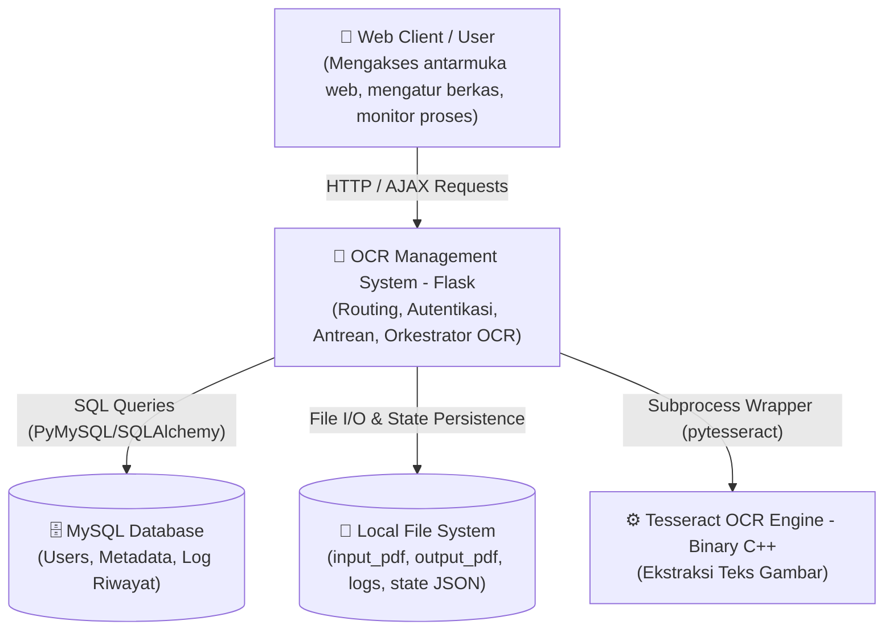
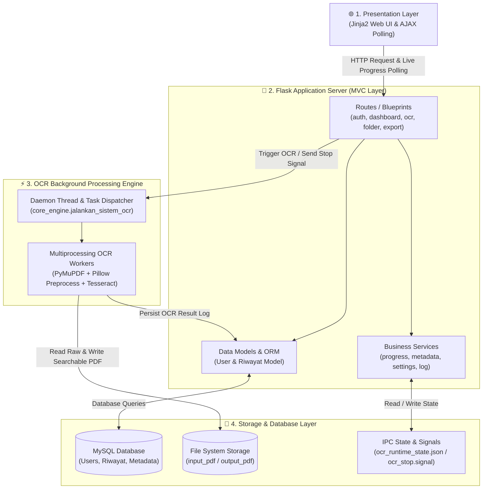
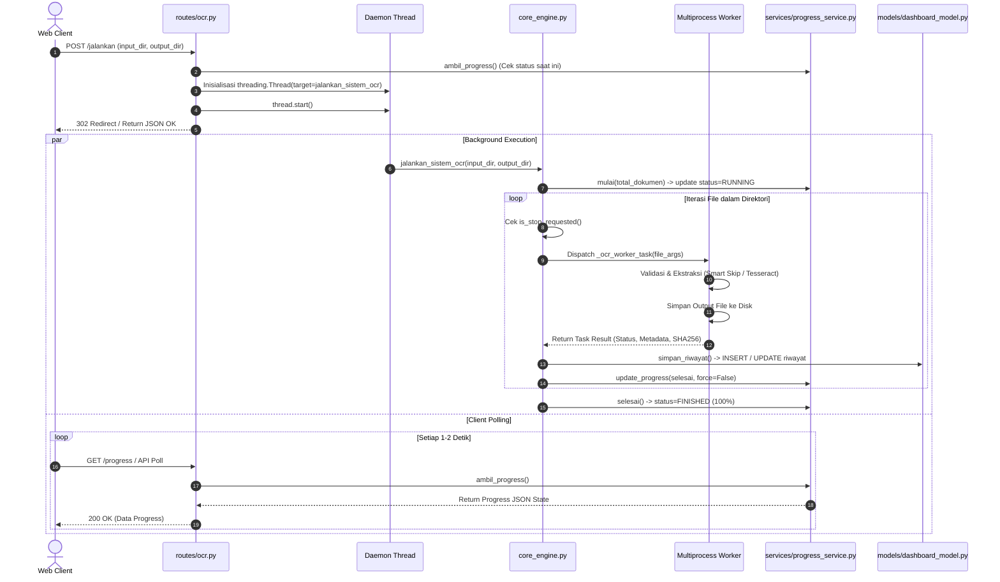
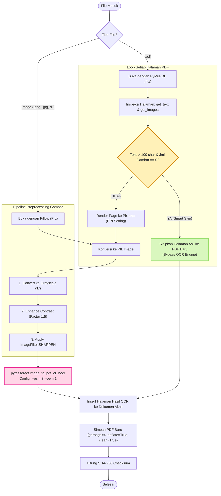
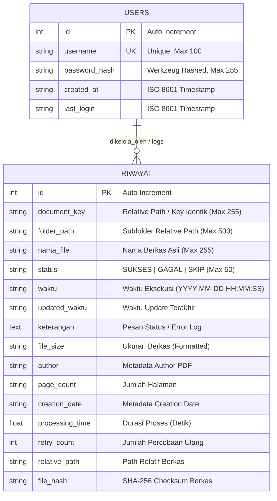

# 🛠️ Arsitektur Teknis Lengkap Sistem OCR (Developer Documentation)

Dokumen ini berisi spesifikasi arsitektur teknis lengkap, diagram komponen, diagram alur data, model konkurensi, dan skema database untuk tim pengembang (*Software Engineers / Developers*).

---

## 1. Topologi Sistem & Arsitektur Tingkat Tinggi (Context - Level 1)

Sistem ini mengadopsi pola **Modular Monolith** dengan eksekusi *asynchronous* berbasis *Daemon Thread* dan *Multiprocessing Worker Pool* untuk menangani beban komputasi OCR yang intensif (*CPU-bound*).



---

## 2. Diagram Kontainer & Aliran Komponen (Container - Level 2)

Diagram ini menggambarkan pembagian 4 lapisan utama sistem secara terstruktur dan terisolasi:



### 📌 Ringkasan Peran 4 Kontainer Utama:
1. **Presentation Layer (Browser):** Antarmuka web pengguna untuk memicu pengerjaan, mengatur folder, dan melakukan *live progress polling* via AJAX.
2. **Flask Application Server (MVC):** Mengatur otentikasi sesi, memvalidasi input, menyediakan endpoint REST/AJAX, dan memisahkan logika bisnis (*Services*) dari akses data (*Models*).
3. **OCR Processing Engine:** Bekerja di latar belakang (*background daemon thread*) dan mendistribusikan berkas ke *worker pool multiprocessing* untuk eksekusi OCR tanpa memblokir server web.
4. **Storage & Persistence Layer:** Menyimpan relasi data di MySQL, berkas fisik PDF/gambar di *file system*, serta status runtime untuk koordinasi antar-proses (IPC).

---

## 3. Alur Kerja Pemrosesan Dokumen & Konkurensi

### A. Sequence Diagram: Eksekusi OCR Asinkronus



---

## 4. Pipeline Pemrosesan Dokumen (Smart Skip & Image Preprocessing)

Setiap halaman dokumen dievaluasi menggunakan hierarki pemrosesan berkecepatan tinggi sebelum dikirim ke Tesseract:



---

## 5. Entity-Relationship Diagram (Database Schema)

Database menggunakan relasi tabel berbasis **Flask-SQLAlchemy**:



---

## 6. Desain Konkurensi & Mekanisme Ketahanan (Resilience Patterns)

| Mekanisme | Implementasi Teknis | Tujuan Arsitektur |
| :--- | :--- | :--- |
| **Thread Isolation** | `os.environ['OMP_THREAD_LIMIT'] = '1'` | Mencegah *thread contention* dan *deadlock* antara C++ OpenMP (Tesseract) dan Python Threading/Multiprocessing. |
| **I/O Debouncing** | `_write_interval = 0.5s` pada `progress_service.py` | Mengurangi beban *disk thrashing* akibat penulisan file `ocr_runtime_state.json` yang terlalu sering. |
| **Atomic State Write** | Menulis ke `state.json.tmp` lalu `os.replace()` | Menghindari *race condition* atau *partial JSON read* saat klien melakukan polling bersamaan dengan update worker. |
| **Graceful Interruption** | `ocr_stop.signal` + `is_stop_requested()` polling | Memungkinkan penghentian proses OCR secara aman tanpa merusak berkas PDF yang sedang disimpan (*atomic file write*). |
| **Memory Management** | `with Image... as img:` + `.close()` & explicit garbage collection | Mencegah kebocoran memori RAM (*memory leaks*) saat memproses ratusan berkas gambar beresolusi tinggi. |
| **Retry Policy** | `maksimal_percobaan = max_retry (default 3)` | Otomatis mencoba ulang pemrosesan jika terjadi galat sesaat (*transient failure*) sebelum menandai status `GAGAL`. |
| **Self-Healing State** | Reset status otomatis di `routes/ocr.py` jika thread mati | Mencegah antarmuka web terkunci dalam status `RUNNING` abadi jika terjadi *unhandled crash*. |

---

## 7. Pemetaan Modul & Struktur Direktori

```text
OCR_Project/
├── app.py                      # Application Entry Point & Blueprint Registration
├── core_engine.py              # Core OCR Processing Engine (PyMuPDF, Pillow, Tesseract)
├── requirements.txt            # Python Dependencies Manifest
│
├── config/
│   └── settings.py             # Global Config (DB URI, Secret Key, Binary Paths)
│
├── models/                     # Data Layer (SQLAlchemy Models)
│   ├── extensions.py           # SQLAlchemy Instance Provider
│   ├── user_model.py           # User Authentication Model & Methods
│   ├── dashboard_model.py      # Riwayat Model & CRUD/Aggregation Queries
│   └── model_provider.py       # Singleton OCRDashboardModel Provider
│
├── routes/                     # Presentation/Controller Layer (Flask Blueprints)
│   ├── auth.py                 # Login, Logout, User Session Management
│   ├── dashboard.py            # Main Dashboard Metrics, Filter, Pagination
│   ├── ocr.py                  # Trigger Background OCR (/jalankan, /stop)
│   ├── folder.py               # Input/Output Path Config & Tree Browsing
│   └── export.py               # Excel (.xlsx) Report Generator (openpyxl)
│
├── services/                   # Business Logic & Infrastructure Layer
│   ├── progress_service.py     # Runtime State, Progress Tracker, Stop Signal
│   ├── metadata_service.py     # File Metadata Extraction (PyMuPDF/PIL)
│   ├── log_service.py          # Rotating File Logger
│   ├── settings_service.py     # Dynamic Settings Management & Path Resolution
│   └── storage_service.py      # Directory Traversal & Path Normalization
│
├── templates/                  # Jinja2 HTML Views
├── static/                     # Assets (CSS, JS, Fonts, Images)
└── logs/                       # Runtime Artifacts (state JSON, signals, log files)
```

---

## 8. Panduan Environment & Eksekusi

### Kebutuhan Dependensi:
* **Python Runtime:** Python 3.8+
* **Dependencies:** `Flask`, `Flask-SQLAlchemy`, `Flask-Login`, `Flask-WTF`, `PyMySQL`, `pytesseract`, `PyMuPDF (fitz)`, `Pillow`, `openpyxl`, `opencv-python-headless`.
* **System Binary:** `tesseract-ocr` dengan data bahasa `tessdata` untuk `ind` (Bahasa Indonesia) dan `eng` (Bahasa Inggris).

### Menjalankan Server:
```bash
# 1. Pastikan virtual environment aktif
source env/bin/activate  # Linux/macOS
# atau
.\env\Scripts\activate   # Windows

# 2. Install dependensi
pip install -r requirements.txt

# 3. Jalankan aplikasi Flask
python app.py
```

---
*Dokumen ini diperbarui secara berkala sesuai dengan evolusi codebase OCR_Project.*
